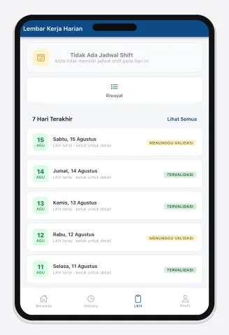
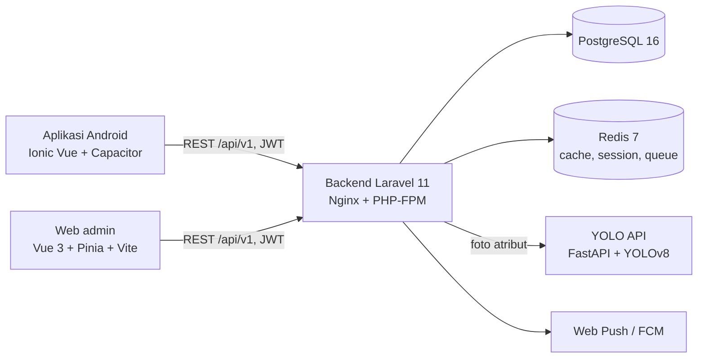
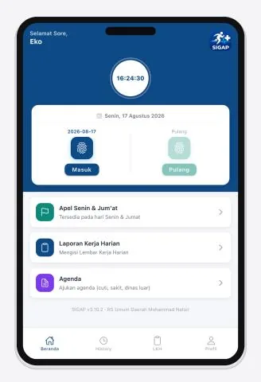
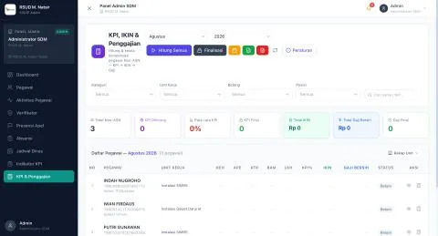

# SIGAP — Sistem Informasi Gerakan Aktivitas Pegawai

> *Employee Activity Movement Information System* — aplikasi SDM rumah sakit untuk absensi, presensi apel, laporan kinerja harian, dan perhitungan KPI sebagai dasar insentif kinerja (IKIN). Dipakai **882 pegawai** RSUD Mohammad Natsir Solok dengan ribuan entri data setiap hari.

| | |
|---|---|
| Instansi | RSUD Mohammad Natsir Solok (rumah sakit umum daerah kelas B), Instalasi SIMRS |
| Peran saya | Programmer → System Analyst: analisis kebutuhan, desain data, backend, frontend, mobile, deployment |
| Pengguna | 882 pegawai, 30+ unit kerja |
| Platform | Web admin, aplikasi Android (Play Store), PWA |
| Status | Produksi, aktif dikembangkan |

## Masalah yang diselesaikan

Sebelum SIGAP, absensi, laporan kinerja harian (LKH), dan rekap apel dikumpulkan terpisah lalu direkap manual untuk menghitung insentif pegawai non-ASN. Rekap lambat, sulit diaudit, dan rawan beda angka antar bagian. SIGAP menyatukan semuanya dalam satu sistem sehingga KPI dan IKIN dihitung otomatis dari data yang sama.

## Fitur utama

**Pegawai (mobile)**
- Absensi berbasis GPS dengan validasi radius lokasi kerja, waktu diambil dari server (jam perangkat tidak dipakai).
- Absensi luar (dinas/remote) dengan foto dan dokumen pendukung, serta absensi saat kendala teknis.
- Presensi apel pagi, dan validasi atribut seragam melalui layanan deteksi citra (YOLOv8).
- Pengajuan izin dan cuti (terlambat, pulang cepat, cuti tahunan, sakit, dinas luar, pendidikan) dengan saldo cuti.
- Banding absensi dengan kuota per bulan.
- Pengisian LKH harian per shift, termasuk pegawai multi-shift dan shift malam.
- Notifikasi push (Web Push / Capacitor).

**Atasan**
- Validasi LKH dan persetujuan izin bawahan secara berjenjang.

**Admin SDM dan manajemen**
- Master pegawai, unit kerja, posisi, golongan, lokasi GPS, hari libur, pola kerja dan jadwal shift (termasuk override jadwal).
- Indikator KPI per posisi dengan bobot, rumus, dan rentang nilai; simulasi KPI sebelum diterapkan.
- Perhitungan IKIN dengan ambang nilai, rekap penggajian, dan ekspor ke Excel/PDF.
- Transfer pegawai antar unit, log aktivitas, mode pemeliharaan aplikasi.
- Dashboard statistik kehadiran dan kinerja.

## Arsitektur

- **Peran**: Super Admin, Admin SDM, Atasan, Pegawai, Manajemen (spatie/laravel-permission + JWT).
- **Keamanan**: rate limit login per username + IP (aman untuk jaringan RS di balik NAT), waktu server sebagai sumber kebenaran, log aktivitas (spatie/activitylog).
- **Kinerja**: indeks khusus PostgreSQL, `pg_stat_statements` untuk memantau query, tuning PostgreSQL dan Redis untuk server ber-RAM terbatas.

## Model data (ringkas)

`pegawai` · `unit_kerja` · `posisi` · `absensi` · `absensi_luar` · `presensi_apel` · `pengajuan_izin` · `banding_absensi` · `lkh` · `indikator_kpi` · `kpi` · `ikin` · `penggajian` · `shift` / `pola_kerja` / `jadwal_override` · `transfer_pegawai` · `push_subscriptions` · `activity_log`

## Tech stack

| Lapis | Teknologi |
|---|---|
| Backend | Laravel 11 (PHP 8.2), JWT (tymon/jwt-auth), spatie/permission, spatie/activitylog, DomPDF, PhpSpreadsheet |
| Frontend admin | Vue 3, Pinia, Vite |
| Mobile | Ionic Vue + Capacitor (Android), PWA |
| Layanan citra | FastAPI, Ultralytics YOLOv8, OpenCV |
| Data | PostgreSQL 16, Redis 7 |
| Infrastruktur | Docker Compose, Nginx, Supervisor, CI/CD, server on-premise RS |

## Deployment dan operasional

- Semua layanan berjalan dalam Docker Compose di server rumah sakit; migrasi skema dijalankan bertahap (40+ migrasi) tanpa menghentikan layanan.
- Aplikasi Android dirilis berkala (seri v3.x) dan dipublikasikan di Play Store.
- Otomasi cron + notifikasi Telegram untuk pemantauan.
- Dokumen proyek: KAK, dokumen desain sistem, hasil uji dan UAT, panduan pengguna, berita acara sosialisasi dan serah terima.

## Galeri

| | |
|---|---|
|  |  |

---

> **Catatan kerahasiaan.** Kode sumber aplikasi ini private karena milik/dipakai instansi. Repo ini hanya menjelaskan konteks, fitur, arsitektur, dan peran saya. Tidak ada kode, data pegawai, data pasien, alamat server, maupun kredensial di sini.

**Maizan Insani Akbar** · Software Engineer & System Analyst · [Portfolio](https://izanmaizan.vercel.app) · [LinkedIn](https://www.linkedin.com/in/izanmaizan/) · [GitHub](https://github.com/izanmaizan)
